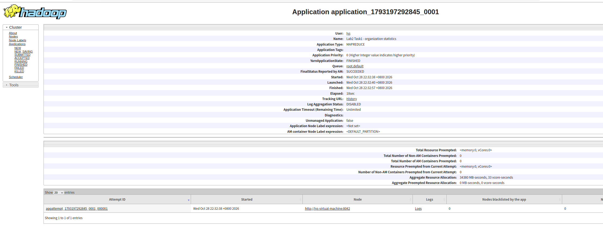
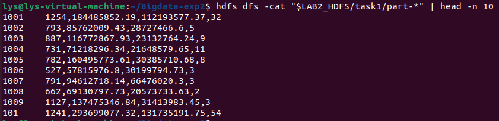
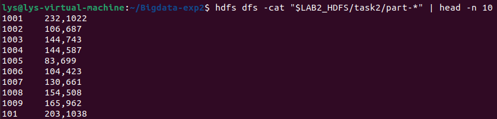
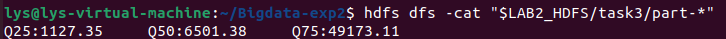
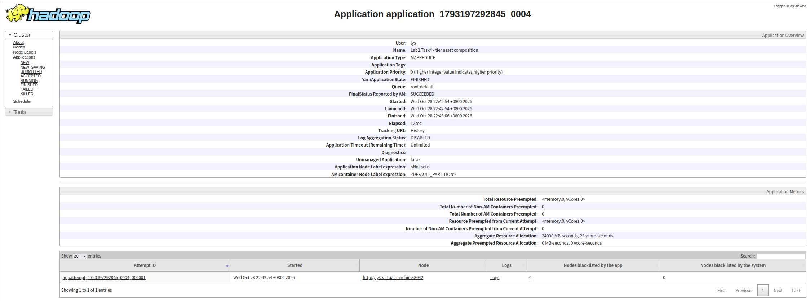
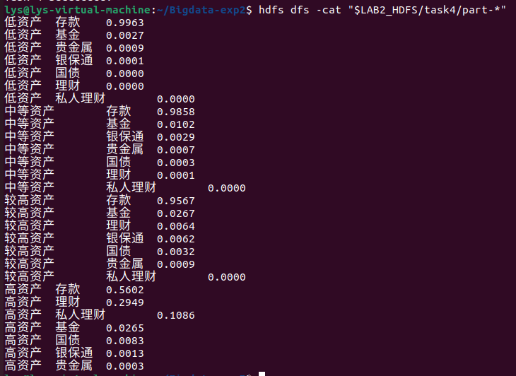
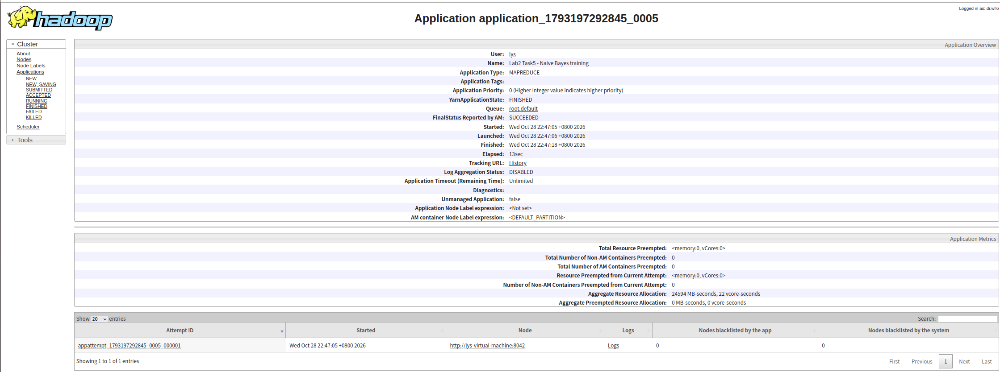
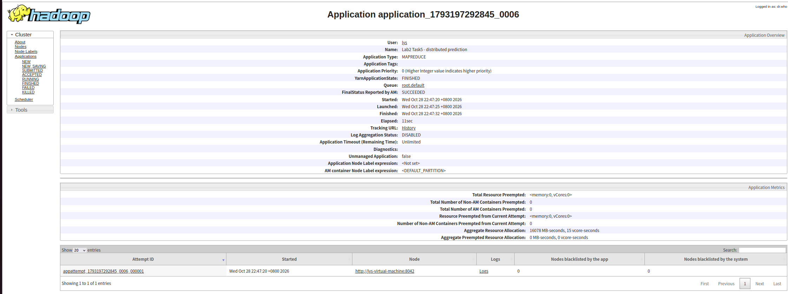
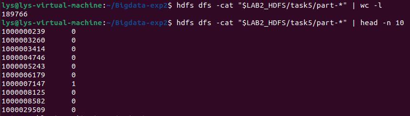
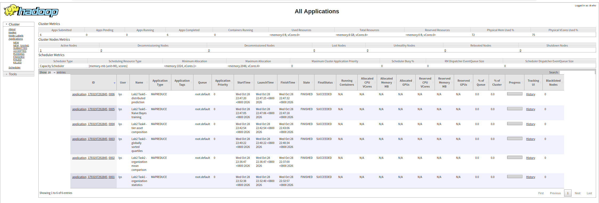

# 实验2

## 一、实验环境

| 项目 | 配置 |
|---|---|
| 运行平台 | Linux 虚拟机，单节点 Hadoop 伪分布式环境 |
| Java | OpenJDK 1.8.0_504 |
| Hadoop | 3.4.0 |
| 存储与调度 | HDFS、YARN |
| 编程语言 | Java 8 |

## 二、项目结构

```text
Bigdata-exp2/
├── src/main/java/lab2/
│   ├── Data.java
│   ├── Task1.java
│   ├── Task2.java
│   ├── Task3.java
│   ├── Task4.java
│   └── Task5.java
├── target/
│   └── credit-mapreduce-lab2.jar
├── output/
│   ├── task1/
│   ├── task2/
│   ├── task3/
│   ├── task4/
│   └── task5/
├── screenshots/
├── pom.xml
├── .gitattributes
├── .gitignore
└── README.md
```

## 三、设计思路与运行结果

### 任务1：各开户机构客户数量以及资产统计

Mapper 以 `OPEN_ORG_NUM` 为键，为每条客户记录输出客户数 1、客户总资产、客户总负债和逾期标签。Combiner 先合并本地相同机构的数据，Reducer 再汇总该机构所有客户的统计量。金额汇总使用 `BigDecimal`，避免连续浮点累加造成金额误差。

输出格式为：

```text
开户机构编号<TAB>客户数量,总资产,总负债,个贷逾期客户数
```

部分实际结果如下：

```text
1001    1254,184485852.19,112193577.37,32
1002    793,85762009.43,28727466.6,5
1003    887,116772867.93,23132764.24,9
1004    731,71218296.34,21648579.65,11
1005    782,160495773.61,30385710.68,8
```

完整输出见 [任务1结果](output/task1/part-r-00000)。

任务 1 的 YARN 页面显示作业成功：



终端中的实际统计结果：



### 任务2：平均值分析

将任务 1 的机构统计结果加入分布式缓存，Mapper 在 `setup` 阶段加载各机构的客户数 `N` 和总资产 `S`。读取客户资产 `A` 后，使用 `A × N >= S` 判断是否属于大于等于平均值的一组，其余客户归入低于平均值的一组。该方法使用 `BigDecimal` 直接比较，不需要先对平均值做小数截断，并将等于平均值的客户归入前一组。

Mapper 分别输出 `1,0` 或 `0,1`，Combiner 和 Reducer 对两个计数求和。输出格式为：

```text
开户机构编号<TAB>大于等于平均值客户数,低于平均值客户数
```
本次输出 **687 行**。部分实际结果如下：

```text
1001    232,1022
1002    106,687
1003    144,743
1004    144,587
1005    83,699
```




### 任务3：客户总资产的四分位数

Mapper 将客户总资产作为 `DoubleWritable` 键，将计数 1 作为值。Combiner 合并相同资产值的出现次数。作业只设置一个 Reducer，由 **Hadoop Shuffle/Sort 按资产数值升序排列所有键**，从而获得全局有序的资产序列。

总样本数 `N` 由任务 1 各机构客户数累加得到。四分位数采用最近秩法：将排序后的数据记为 `x(1), …, x(N)`，令 `Q(p) = x(ceil(p × N))`，其中 `p` 分别为 0.25、0.50、0.75。Reducer 按键顺序累加频数，在累计计数跨过目标秩时记录相应资产值。

本次 `N = 285285`，对应的三个目标秩为 **71322、142643、213964**。实际输出为：

```text
Q25:1127.35    Q50:6501.38    Q75:49173.11
```




### 任务4：客户资产分层与资产结构统计

将任务 3 的四分位数加入分布式缓存，按以下区间确定客户等级。边界相等时归入较低的对应层级。

| 资产等级 | 本次分层区间 |
|---|---|
| 低资产 | `资产 <= 1127.35` |
| 中等资产 | `1127.35 < 资产 <= 6501.38` |
| 较高资产 | `6501.38 < 资产 <= 49173.11` |
| 高资产 | `资产 > 49173.11` |

Mapper 以等级编号 0～3 为键，输出七类资产金额。Combiner 先求局部和，Reducer 再按等级汇总存款、理财、私人理财、基金、国债、银保通和贵金属金额。

本实验将某等级内七类资产汇总额之和作为占比分母，即 `某类资产占比 = 该等级内该类资产总额 / 该等级内七类资产总额之和`。分母为零时，各类占比输出零；即使某一等级没有客户，也保留该等级的七条结果。

等级键由 Hadoop 按 0～3 排序，因此等级顺序为低资产、中等资产、较高资产、高资产。每个 Reducer 分组内仅对七类汇总占比进行简单选择排序，按占比从高到低输出。显示时保留四位小数，排序依据使用四舍五入到四位之前的占比。

| 资产等级 | 存款 | 理财 | 私人理财 | 基金 | 国债 | 银保通 | 贵金属 |
|---|---:|---:|---:|---:|---:|---:|---:|
| 低资产 | 0.9963 | 0.0000 | 0.0000 | 0.0027 | 0.0000 | 0.0001 | 0.0009 |
| 中等资产 | 0.9858 | 0.0001 | 0.0000 | 0.0102 | 0.0003 | 0.0029 | 0.0007 |
| 较高资产 | 0.9567 | 0.0064 | 0.0000 | 0.0267 | 0.0032 | 0.0062 | 0.0009 |
| 高资产 | 0.5602 | 0.2949 | 0.1086 | 0.0265 | 0.0083 | 0.0013 | 0.0003 |

低资产、中等资产和较高资产组的存款占比分别为 **99.63%、98.58%、95.67%**；高资产组存款占比下降到 **56.02%**，理财和私人理财分别占 **29.49%**、**10.86%**。在本样本中，高资产客户的资产配置种类更分散，理财及私人理财的占比更高。由于各占比显示到四位小数，显示值合计可能略偏离 1。





### 任务5：基于 MapReduce 的客户风险预测

本任务使用高斯朴素贝叶斯与伯努利朴素贝叶斯相结合的分类方法，分为模型训练和分布式预测两个 MapReduce 作业。

**特征构造。** 数值特征共 10 个，包括七类资产金额、资产总额、负债总额和贷款账户月余额。建模时将负金额截为零，再做 `log1p(x)` 变换，以减小金额跨度对数值计算的影响；任务 1～4 的金额统计不进行这种截断。二值特征共 6 个，包括 `LOAN_FLAG`、`CRED_FLAG` 和四个资产等级的独热编码。客户号只用于标识输出记录，客户号和机构编号均不作为模型特征。

**模型训练。** 训练 Mapper 加载缓存中的四分位数，构造特征，并按 `bad_good` 分别在本地累加样本数、数值特征之和、平方和以及二值特征的 1 次数。Mapper 结束时只输出两个类别的统计量。Combiner 和 Reducer 继续合并这些统计量，形成模型参数文件，供后续预测使用。其中类别 0 使用 280401 条记录，类别 1 使用 4884 条记录。

**分布式预测。** 预测作业以 `test.csv` 为输入，Mapper 在 `setup` 中通过分布式缓存加载模型与四分位数。类别先验取训练集中各类的频率；数值特征使用高斯分布，方差下限设为 `1e-6`；二值特征使用加一平滑，其概率为 `(该类特征为1的次数 + 1) / (该类样本数 + 2)`。计算时累加对数概率，选择分数较高的类别，分数相同时输出 0。

预测阶段不需要按客户聚合，因此设置 **0 个 Reducer**，由 Mapper 直接输出：

```text
CUST_ID<TAB>预测bad_good
```

实际输出的前 10 行为：

```text
1000000239    0
1000003260    0
1000003414    0
1000004746    0
1000005243    0
1000006179    0
1000007147    1
1000008125    0
1000008582    0
1000029509    0
```

预测文件共 **189766 行**，客户号无重复，且与测试集客户号完全对应。

| 预测标签 | 客户数 | 占测试集比例 |
|---|---:|---:|
| 0 | 184608 | 97.2819% |
| 1 | 5158 | 2.7181% |

模型训练作业成功页面：


分布式预测作业成功页面：


预测条数及部分预测结果：



## 四、运行成功记录

五项任务共提交六个作业，因为任务 5 包含训练与预测两个阶段。下表中的作业编号、Mapper/Reducer 数量由实际日志核对。

| 任务 | Job ID | Mapper 数 | Reducer 数 | 状态 |
|---|---|---:|---:|---|
| 任务1 | `job_1793197292845_0001` | 1 | 1 | SUCCEEDED |
| 任务2 | `job_1793197292845_0002` | 1 | 1 | SUCCEEDED |
| 任务3 | `job_1793197292845_0003` | 1 | 1 | SUCCEEDED |
| 任务4 | `job_1793197292845_0004` | 1 | 1 | SUCCEEDED |
| 任务5训练 | `job_1793197292845_0005` | 1 | 1 | SUCCEEDED |
| 任务5预测 | `job_1793197292845_0006` | 1 | 0 | SUCCEEDED |

YARN 总览中六个作业的状态均为 `FINISHED`，最终状态均为 `SUCCEEDED`：



## 五、不足与可能的改进

1. **单 Reducer 的扩展性有限。** 为便于输出检查，任务 1～4 和训练作业均使用一个 Reducer。数据量扩大后，任务 1、2 可增加 Reducer 数量，按机构分区并行汇总；任务 3 可采用全序分区，并结合各分区样本数的前缀和定位全局分位数。

2. **机构间数据量可能不均衡。** 若部分机构的客户量明显更多，多 Reducer 场景下可能出现数据倾斜。现有 Combiner 已减少局部重复传输，进一步可对大机构增加局部聚合阶段，再合并机构级结果。

3. **类别不平衡且缺少独立效果评估。** 训练集中逾期标签约占 1.7120%。后续可在训练集内部按类别分层划分训练集与验证集，只用训练部分计算分层阈值和模型参数，再在验证集上评估召回率、F1、ROC-AUC 和 PR-AUC。现有无标签测试集只能生成预测，无法直接计算这些指标。
